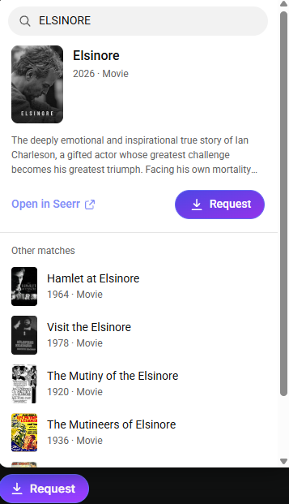
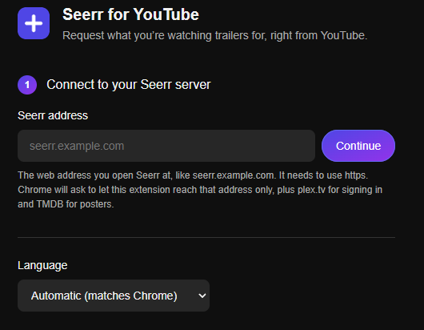

# Seerr for YouTube

[](https://claude.ai)
[](LICENSE)
[](#)
[](#installation)

**Watching a trailer on YouTube? Request it on your Seerr server in one click.**

Seerr for YouTube is a Chrome extension that adds a **Request** button next to YouTube's Subscribe button. It works out which movie or show the trailer is for, shows whether it's already on your server, and lets you request it, picking seasons for shows, without ever leaving YouTube.

> [!IMPORTANT]
> **This project was created 100% with [Claude](https://claude.ai), Anthropic's AI assistant.**
> Every line of code, all translations, the icons and this README were written by Claude through conversation on claude.ai. The project owner directed the work, tested it on real servers and made the design decisions.

> [!NOTE]
> **Free to use, copy and modify, with credit, for non-commercial purposes only.**
> Licensed under [CC BY-NC 4.0](LICENSE). See [License](#license) for what that means.

<table>
  <tr>
    <td align="center" valign="top">
      <br>
      <sub>The request popover: best match, status and other possible matches</sub>
    </td>
    <td align="center" valign="top">
      <br>
      <sub>First-time setup: enter your Seerr address, then sign in</sub>
    </td>
  </tr>
</table>

---

## Contents

- [Features](#features)
- [Languages](#languages)
- [Requirements](#requirements)
- [Installation](#installation)
- [Using it](#using-it)
- [Privacy and security](#privacy-and-security)
- [Troubleshooting](#troubleshooting)
- [Known limitations](#known-limitations)
- [Project structure](#project-structure)
- [License](#license)
- [Credits](#credits)

---

## Features

**Requesting**
- **One-click requests from YouTube.** The button sits next to Subscribe and matches YouTube's look, in Seerr's colours.
- **Status at a glance.** On trailers, the button already shows **Request**, **Requested** or **Available** before you click it.
- **Season picker for shows.** Choose one season or all of them. Seasons already available or requested are marked and can't be requested twice.
- **Smart preselection.** "Season 2" in the trailer title preselects Season 2. This includes anime naming like 第2期 and "2nd Season".
- **Never stuck with a wrong match.** The popover lists other possible matches, has a search box, and links to the title in Seerr.

**Finding the right title**
- **Cleans up trailer titles** like "Dune: Part Two | Official Trailer 3 | In Theaters" down to *Dune: Part Two*.
- **Understands trailer titles in English, Japanese, Korean and Arabic**, including titles in brackets such as 『葬送のフリーレン』 or 《파묘》.
- **Searches in the trailer's language**, so a Japanese trailer finds 葬送のフリーレン under its Japanese title.
- **Recognises video game trailers.** It uses the title, the channel and YouTube's game card, and doesn't offer to request games. It's tuned not to mistake shows like *The Last of Us* or *Squid Game* for games.

**Accounts**
- **Sign in with Plex.** Each person uses their own account, so requests show up under their name with their own approval rules and limits.
- **Jellyfin, Emby and local accounts** work by signing in on your Seerr site; the extension picks that up automatically.
- **Sign in from YouTube.** If you're signed out, the popover offers sign-in right there.

**Comfort**
- **Follows YouTube's light and dark mode.**
- **"Only show on trailers" option** hides the button on everything else, including game trailers.
- **Lightweight.** It only looks titles up on trailers, never on every video. Posters are small and the cache is capped.

## Languages

| Language | Interface | Understands trailer titles | Notes |
|---|:-:|:-:|---|
| English | ✅ | ✅ | |
| 日本語 Japanese | ✅ | ✅ | Includes anime conventions: PV, 本予告, 第2期, 劇場版 |
| 한국어 Korean | ✅ | ✅ | |
| العربية Arabic | ✅ | ✅ | Full right-to-left layout |

The interface follows Chrome's language automatically. You can change it under **Language** on the settings page; the change applies instantly, including on open YouTube tabs.

## Requirements

- **Google Chrome**, or another Chromium-based browser such as Edge, Brave, Opera or Vivaldi.
- **A Seerr server reached through an https domain address**, like `seerr.example.com`. IP addresses and plain `http://` aren't supported, so that sign-ins are never sent unencrypted.
- **An account on that Seerr server**: Plex, or a Jellyfin, Emby or local Seerr account.

> Built for [Seerr](https://github.com/seerr-team/seerr). Overseerr and Jellyseerr share the same API and may work, but they haven't been tested.

## Installation

The extension isn't on the Chrome Web Store, so you install it directly from this repository.

1. **Download it.** Click **Code → Download ZIP** at the top of this page (or download the latest release), then unzip it somewhere permanent, such as your Documents folder.
   > Chrome runs the extension from that folder. If you delete or move the folder, the extension stops working.

   Or clone it with git:
   ```bash
   git clone https://github.com/nigoshi/seerr-for-youtube.git
   ```
2. **Open Chrome's extensions page.** Go to `chrome://extensions` (in Edge: `edge://extensions`).
3. **Turn on Developer mode** with the switch in the top-right corner (in Edge, it's in the left sidebar).
4. **Click "Load unpacked"** and select the **`extension`** folder inside the download (the folder that contains `manifest.json`).
5. **Connect to your server.** The settings page opens by itself. Type your Seerr address, for example `seerr.example.com`, click **Continue** and choose **Allow** when Chrome asks.
6. **Sign in.** Click **Sign in with Plex** and approve in the Plex window. For other account types, click **Use another sign-in** and sign in on your Seerr site.
7. **Done.** Click **Back to YouTube** and open any trailer.

Tip: pin the extension from Chrome's puzzle-piece menu. Clicking its icon opens the settings page.

### Updating

Download the new version and replace the contents of your `extension` folder with it. Then click the reload icon ↻ on the extension's card in `chrome://extensions`, and refresh any open YouTube tabs.

## Using it

1. Open a movie or TV trailer on YouTube.
2. The button next to Subscribe shows the title's status:

   | Button | Meaning |
   |---|---|
   | **Request** (purple) | Found on Seerr and not requested yet |
   | **Requested** (amber) | Already requested |
   | **Available** (green) | Already on your server |
   | **Seerr** | Not looked up yet, not sure of the match, or a video game trailer. Click to search |

3. Click it to open the popover. Check the match, choose seasons for a show, and click **Request**.
4. Wrong match? Pick one from **Other matches**, or type a title in the search box and press Enter.

## Privacy and security

- **No data collection.** No analytics, no tracking, no third-party servers. The extension only talks to:
  - **your Seerr server**, for searches and requests;
  - **plex.tv**, only when you click "Sign in with Plex";
  - **image.tmdb.org**, to load posters.
- **No passwords or API keys are stored.** The extension uses your normal Seerr sign-in, the same one Seerr's website uses. Your Plex sign-in token is handed to Seerr once and never saved.
- **Minimal permissions.** Chrome only grants access to your exact Seerr address, plus plex.tv and image.tmdb.org. Access is requested when you connect, not at install.
- **Isolated from YouTube.** The button and popover are sealed off from YouTube's page scripts, which can't read your name, server address or library, and can't press **Request** for you.
- **https only.** The extension refuses unencrypted addresses, so sign-ins never travel in plain text.

## Troubleshooting

| Problem | What to do |
|---|---|
| The button doesn't appear | Refresh the YouTube tab. If you just installed or updated the extension, already-open tabs don't have it yet. |
| "Seerr sent back a web page instead of data" | Your Seerr is behind a login proxy (Authelia, Authentik, etc.). Let `/api` paths through the proxy. |
| "Seerr's CSRF protection blocks extensions" | Turn off CSRF protection in Seerr under **Settings → Network**. |
| "Your Plex account doesn't have access" | Ask the server owner to import your Plex user in Seerr. |
| No posters, just a film-strip icon | On the settings page, click **Change**, then **Continue**, and allow access when Chrome asks. |
| Two Request buttons | You have two copies installed. Remove the old one in `chrome://extensions`. |

## Known limitations

- **YouTube changes.** The button attaches next to YouTube's Subscribe button. If YouTube redesigns its watch page, the button may not appear until the extension is updated.
- **Title-based matching.** Matches are worked out from the video title. Usually the first match is right; when it isn't, use **Other matches** or the search box.
- **Game detection is a best guess.** It combines several signals, but an unusual game trailer may slip through, or a film may be held back. You can always search by hand.
- **AI-written translations.** Corrections from native speakers are very welcome.
- **Not on the Chrome Web Store**, so it's installed with Developer mode, as described above.

## Project structure

```
seerr-for-youtube/
├── extension/            ← load this folder in Chrome
│   ├── manifest.json     Extension definition (Manifest V3)
│   ├── background.js     Talks to Seerr, Plex sign-in, security checks
│   ├── content.js        The button and popover on YouTube
│   ├── match.js          Reads trailer titles, detects game trailers, ranks matches
│   ├── i18n.js           All interface text (English, Japanese, Korean, Arabic)
│   ├── net.js            Address checks (https domain addresses only)
│   ├── styles.js         Button and popover styles
│   ├── options.html/css/js  Settings page
│   ├── icons/            Extension icons
│   └── _locales/         Extension name in Chrome's own lists
├── screenshots/          Images used in this README
├── LICENSE               CC BY-NC 4.0
└── README.md
```

There's no build step and there are no dependencies: plain JavaScript, HTML and CSS.

## License

**Seerr for YouTube** © 2026 Nigoshi is licensed under the [Creative Commons Attribution-NonCommercial 4.0 International License (CC BY-NC 4.0)](https://creativecommons.org/licenses/by-nc/4.0/).

The source code is open for anyone to read, use, copy and modify, as long as these two conditions are followed:

✅ **You may**
- use this extension yourself, at home, in your family, or in your community;
- copy it and share it with others;
- modify it, translate it, build on it, and share your modified versions.

📌 **You must give credit**
- Credit the original project and author, link to this repository, and say if you made changes. For example:
  > Based on [Seerr for YouTube](https://github.com/nigoshi/seerr-for-youtube) by Nigoshi, licensed under CC BY-NC 4.0. Changes were made.

🚫 **You may not use it for profit**
- Neither this project nor anything made from it may be used commercially: no selling it, no paid versions, no including it in paid products or services, no ads or monetisation built on it.

These conditions also apply to every project based on this one. The full legal text is in [LICENSE](LICENSE) and is what applies; this summary is just a plain-language guide.

## Credits

- **Written entirely by [Claude](https://claude.ai)**, Anthropic's AI assistant, in collaboration with the project owner.
- Built for **[Seerr](https://github.com/seerr-team/seerr)**, the open-source media request manager.
- Movie and show posters come from **[TMDB](https://www.themoviedb.org/)**. This product uses the TMDB API but is not endorsed or certified by TMDB.

*This project isn't affiliated with or endorsed by YouTube or Google, the Seerr project, Plex, TMDB, or Anthropic. All trademarks belong to their owners.*
